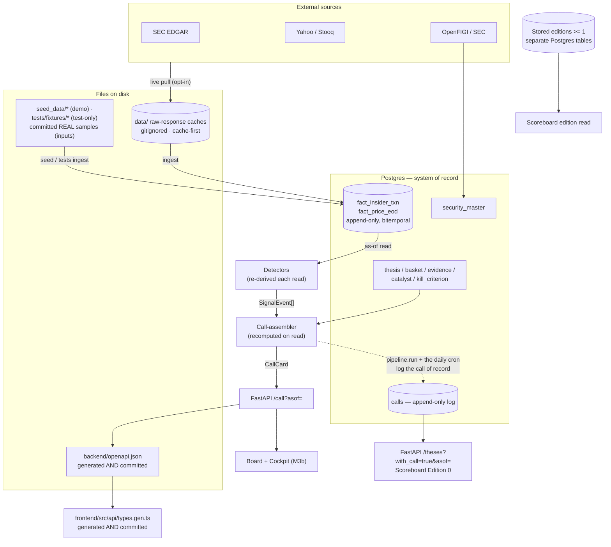

# Alpha Deck — Data Flow (where everything lives)

> An anti-black-box reference: what is a **file on disk** vs. what lives in the **database** vs. what is
> **recomputed on the fly**. Companion to [`PROJECT_OVERVIEW.md`](PROJECT_OVERVIEW.md) (the *why*) and
> [`CALL_LOGIC.md`](CALL_LOGIC.md) (how a call is made).

## The one rule

**Postgres is the operational system of record for the thesis, facts and calls.** Files also hold working
state, provenance and recovery artifacts; `data/` is not all disposable cache:

1. **Committed inputs** — real captured samples. The shared HIMS demo samples live in `backend/seed_data/` (read by `pipeline/seed.py` *and* the real-data tests); test-only samples live in `backend/tests/fixtures/`. Static; never written at runtime.
2. **Gitignored runtime files** (`data/`, mounted as `/data` in containers) — raw-response caches, mutable triage sessions, draft-run provenance, backups and research artifacts. Their retention needs differ; see the table below before deleting anything.
3. **Generated, committed contracts** — `backend/openapi.json` and `frontend/src/api/types.gen.ts`. Regenerate both together when the API schema changes; CI checks for drift.

The auditable distinction is **recomputed calls vs recorded calls**, not "nothing is stored."
`/theses/{id}/call?asof=` re-derives signals from facts and assembles a call without writing call/fact rows.
`/theses?with_call=true&asof=` reads the nightly record instead; Scoreboard Edition 0 reads that log, while
editions ≥ 1 read stored public-clock re-runs. There is no separate mutable signal-firing layer; recorded
cards retain what the system said, with provenance. Authentication may update session/token usage timestamps
(`AUTH.md`); the no-write claim here concerns the call computation, not all request bookkeeping.

## The pipeline

```
                       EXTERNAL SOURCES (the internet)
        SEC EDGAR (Form 4)   ·   Yahoo/Stooq (EOD)   ·   OpenFIGI/SEC (identity)
                       │  live pull — only when you ask (allow_live), polite + rate-limited
                       ▼
        ┌──────────────────────────────────────────────┐
        │  data/ raw-response caches (gitignored)      │  cache-first: read if present,
        │  edgar_cache/ price_cache/ figi_cache/ ...     │  else fetch ONCE and write here.
        └──────────────────────────────────────────────┘  A mirror, NOT the source of truth.
                       │ ingest                 ▲
                       │             committed REAL samples (INPUTS — never written at runtime)
                       │      backend/seed_data/ (HIMS demo) · tests/fixtures/ (test-only samples)
                       │                        │ ingest (seed + tests read these)
                       ▼                        ▼
        ╔══════════════════════════════════════════════════════════════╗
        ║  POSTGRES — thesis, facts and call records                    ║
        ║  security_master · fact_insider_txn · fact_price_eod          ║  fact_* = append-only,
        ║  thesis / basket / evidence / catalyst / kill · calls (log)   ║  bitemporal; master mutable
        ╚══════════════════════════════════════════════════════════════╝
                       │ as-of read (history judged on the PUBLIC clock)
                       ▼
        Detectors  ──►  SignalEvent[]        ◄── RE-DERIVED for /call; no standalone firing store
                       │
                       ▼
        Call-assembler  ──►  CallCard        ◄── pure; /call recomputes without writing a call;
                       │                         pipeline.run + the daily cron append to `calls`
                       │                         (record reads and Scoreboard Edition 0 use that log)
                       ▼
        FastAPI   /theses/{id}/call?asof=   ──►  Board + Cockpit  (M3b)
                       │
                       └─►  backend/openapi.json  ──►  frontend/src/api/types.gen.ts
                            (both generated AND committed)
```

Same as a flowchart (renders on GitHub):



## Where every piece of data lives

| Artifact | Kind | Location | Written when | In git? |
|---|---|---|---|---|
| Wells Form 4 + HIMS EOD (the demo seed) | real captured **input** | `backend/seed_data/` | once, by hand (committed) | **yes** |
| Sample EDGAR / FIGI / price fixtures (tests) | real captured **input** | `backend/tests/fixtures/` | once, by hand (committed) | **yes** |
| EDGAR / price / FIGI raw responses | **cache** of live pulls | `data/` | on a live fetch (cache-first) | no (gitignored) |
| OpenAPI + frontend types | generated contract | `backend/openapi.json` + `frontend/src/api/types.gen.ts` | `app.openapi_export` + `npm run gen:api`; committed together, CI diff-guarded | **yes** |
| Resolved securities | identity (mutable) | **Postgres** `security_master` | on resolve / seed / **populate** (the broadener) | n/a (DB) |
| Insider txns, EOD bars | bitemporal **facts** | **Postgres** `fact_*` | on ingest / seed / the per-thesis `ingest_thesis` + the daily cron (incremental) | n/a (DB) |
| Thesis + basket (incl. `segment` / `authored_by` / `thesis_fit`) + `term_set` (the discovery SIGNAL/BROAD terms, jsonb) + evidence/catalyst/kill | the spine (operational) | **Postgres** | on `upsert` / promote / seed; `term_set` via `POST .../terms` (`set_term_set` — the sole writer) | n/a (DB) |
| Assembled calls (the call-of-record) | accountability **log** | **Postgres** `calls` | by batch `pipeline.run`, or per (thesis, day) by the daily cron's `record_if_changed` (only on change); never on a `/call` GET | n/a (DB) |
| `SignalEvent[]` | **recomputed** | in memory; no separate firing table | each call computation | n/a |
| `CallCard` | computed or recorded, depending on the read | in memory; recorded copies in `calls`, re-run pages in `edition_call` | `/call` recomputes; record/edition reads do not reassemble | n/a (DB) |
| Narrative → chain **draft** | returned recommendation, not a spine/fact write | `/draft-chain` reads the stored `term_set`; completed jobs write best-effort provenance in `data/draft_runs/` | each draft; the operator's promote writes the spine | no (files gitignored) |

**Storage / retention classes** (examples, not an exhaustive inventory):

| Class | Location / producer | Deletion and recovery boundary |
|---|---|---|
| Refetchable raw cache | `data/edgar_cache/`, `data/price_cache/`, `data/figi_cache/`; ingest clients | A missing response can be fetched again only while its upstream source is available; a mutable response may differ. Cache deletion is not a backup policy. |
| Mutable triage working state | `data/triage_sessions/<thesis_id>/latest.json`; `workbench/triage_store.py` | Autosave overwrites the one current session; no version archive. Deleting it loses unpromoted work; the operator's explicit start-over removes it. |
| Draft provenance | `data/draft_runs/`; `workbench/draft_run_log.py` | Best-effort, append-per-completed-job record of inputs and returned draft. A new draft is not a recovery of the same run; the optional loader seeds editor state, never facts or placements automatically. |
| DB backups | `data/backups/`; `pipeline/backup.py` | Plain-SQL database dumps, subject to the documented unlabeled/labeled retention rules in `FEED_LOOP.md`. They do **not** back up triage sessions, draft runs or all appdata files. |
| Research artifacts | `data/backtest/`; `backtest/store.py` | Immutable run directories plus a registry and frozen mirrors. Preserve artifacts cited as evidence; re-running is a new run, not restoration of the old one. The prod archive is a separate read-only bind (`DEPLOY.md`). |

Container appdata survives an image rebuild, but deleting its volume loses the files it holds. Backups and
research binds can live outside that volume; check the applicable Compose mounts before cleanup. Do not
treat a DB dump as a complete filesystem backup.

## Your question, directly

- **The "HIMS files" are two committed real-data samples** — `seed_data/edgar/hims_wells_form4.xml` (the actual Wells Form 4) and `seed_data/prices/HIMS.yahoo.json` (real HIMS EOD) — read by both `pipeline/seed.py` and the real-data tests. They live outside the test tree so shipped code never depends on `tests/`, and they exist so the seed and tests run **deterministically and offline**. They are *inputs*, read-only at runtime.
- **At runtime, HIMS data lives in Postgres** (its `security_master` row, its `fact_*` rows, its `thesis` rows) — exactly like any other name would. Add another ticker and *its* facts + thesis land in the same tables; nothing about HIMS is special in storage.
- **Are files written each time?**
  - *Seeding / tests:* **no** — they read the committed fixtures and write to the **database**.
  - *Live pulls* (when you fetch a name from EDGAR/Yahoo): **yes, raw-response cache files** — a politeness/repro mirror. The surrounding job may also write run/provenance artifacts; not everything under `data/` is disposable.
  - *Serving a call* (`/call?asof=`): the computation reads the DB and recomputes without writing call/fact rows or files; authentication usage bookkeeping is separate. The `calls` log is written by the batch `pipeline.run` / the daily cron, never by this call GET.

## Read path vs. write path

- **Write (ingest):** sources → (cache) → `fact_*` tables. Append-only: a correction is a *new row* with a later `recorded_at`, never an overwrite. The back-half facts (insider Form 4 + EOD) are written by the per-thesis `ingest_thesis` + the daily cron, through the swappable **price-source seam** (`get_bars` — Yahoo/Stooq adapters), **incrementally** (only new bars / unseen filings, so a re-run appends nothing). The thesis spine is upserted; evidence is append-only.
- **Read (serve a call):** `/theses/{id}/call?asof=` loads the thesis, **re-derives** the dated signals from the facts as-of that date (for a past `asof`, on the PUBLIC clock: only facts PUBLIC by the end of that night — EDGAR's next open, 06:00 ET the next weekday (F6) — each filing from its acceptance / filing date, each bar from its settle, a correction from its own publication — `serve_view`, `db/public_clock.py`, `INVARIANTS.md` #4), runs the assembler, and returns the `CallCard` — the call computation **writes no call/fact rows** (a refetch or as-of scrub does not append a call). The call of record is logged separately — by the batch `pipeline.run` or the **daily cron** (`record_if_changed`, appended only on change).
- **Read (record):** `/theses?with_call=true&asof=YYYY-MM-DD` returns the nightly call in effect at that date (greatest `(asof, seq)` on or before it), without recomputing; `null` means no record. `record_asof` can be earlier than the requested date.
- **Read (Scoreboard):** built, not parked. Edition 0 scores the original `calls` log; editions ≥ 1 read separate stored public-clock re-runs. The default is the newest published edition (0 if none, unless configured otherwise). See [`SCOREBOARD.md`](SCOREBOARD.md) for the record/edition distinction and frozen outcomes.

## The feed loop (M2 — how the platform feeds itself)

The create/promote path writes only the spine, so a fresh thesis has no call-engine facts and stays
Incubating. **M2 closes that** (full detail: `FEED_LOOP.md`). *(Freshness caveat: "feeds itself" was literally
true only after #196 — the EDGAR cache froze insider data ~11 days until the key-classed 12h TTL;
`POSTMORTEM_CRON_FREEZE_2026-07.md`.)*

- **The per-thesis ingest** (`pipeline.ingest_thesis`) loops a thesis's **resolved** basket (`master.get`,
  exact membership #2) and writes the back-half **facts** (insider Form 4 → `fact_insider_txn`, EOD →
  `fact_price_eod`) — **incrementally** (only unseen accessions / bars newer than the latest stored), each leg
  fail-visible, `recorded_at=now` (no-lookahead). Prices flow through the **price-source seam** (`get_bars` —
  Yahoo / Stooq adapters, swappable); the recurring path **force-refreshes** the price cache (a cache hit
  returns stale). The **EDGAR** cache is kept fresh differently — a **key-classed 12h TTL** (`forms/*`
  immutable, `submissions`/`companyfacts`/`efts` re-fetch when live), NOT a per-call flag; before that TTL
  (#196) the cron silently froze on cached insider indexes for ~11 days (`DATA_SOURCES.md:45–58`,
  `POSTMORTEM_CRON_FREEZE_2026-07.md`).
- **The daily cron** (`pipeline.daily`) does this per thesis (`list_all`), then **assembles the day's call
  WITHOUT writing** (`call_for_thesis(record=False)`) and **appends the call-of-record only if it changed**
  (`record_if_changed`; `asof=today`, `known_at=now`).
- **The call-of-record is the forward RECORD** the built Scoreboard reads as Edition 0 — the latest version per
  (thesis, day); Scoreboard-**ready**, not Scoreboard-**coupled**.
- **Option B is intact.** The cron writes **facts + the call-of-record log**, not a mutable signal cache.
  `/call` re-derives; record reads use `calls`, and stored edition reads use their own tables.
  *("Feeds itself" is the DATA loop — it is **not** "validated forward"; the Scoreboard's existence does not
  establish forward validation.)*

## Why this isn't a black box

- **Explicit read modes.** `/call` derives signals and the call from facts; recorded-call and edition reads show stored output with its provenance, not a hidden mutable cache of "what the system thinks."
- **Provenance on everything.** Every fired trigger carries its source + the computation (the EDGAR filing link, the price/volume numbers). If we can't show the work, we don't surface the result.
- **Append-only, bitemporal facts.** You can always ask "what did we know, and when?" Corrections never rewrite history. *(This is the `fact_*` tables — the `no_update` trigger. `security_master` is **identity metadata, mutable**: the broadener UPDATEs a name in place. It is not an append-only fact, so the master keeps only the current mapping, not a rename history — fine, because nothing reads the master as-of.)*
- **Deterministic, not model-sourced.** Triggers fire from code against data; the LLM, live in **two Workbench seams** — the FLAG-explanation drafter and the narrative→chain drafter — only drafts *explanation* prose / *chain structure + names + thesis-fit prose* and **never invents a number or a signal**. Both are write-safe: the explanation rides a separate rail (no DB conn); the chain drafter's `POST /workbench/theses/{id}/draft-chain` writes **no spine or fact rows** (a read-only DB conn, test-enforced), though a completed job writes draft-run provenance to disk. The operator's **promote is the spine writer** (and it rejects any placed id that isn't an exact master member). See `WORKBENCH_EXTRACTION.md` + `CHAIN_DRAFTER.md`.
- **No lookahead.** Historical recomputes and backtests judge facts on the PUBLIC clock: publication/acceptance, settled bars, and a correction's own publication, never before. `recorded_at` remains honest store-time bookkeeping, not the historical eligibility gate (`INVARIANTS.md` #4).
